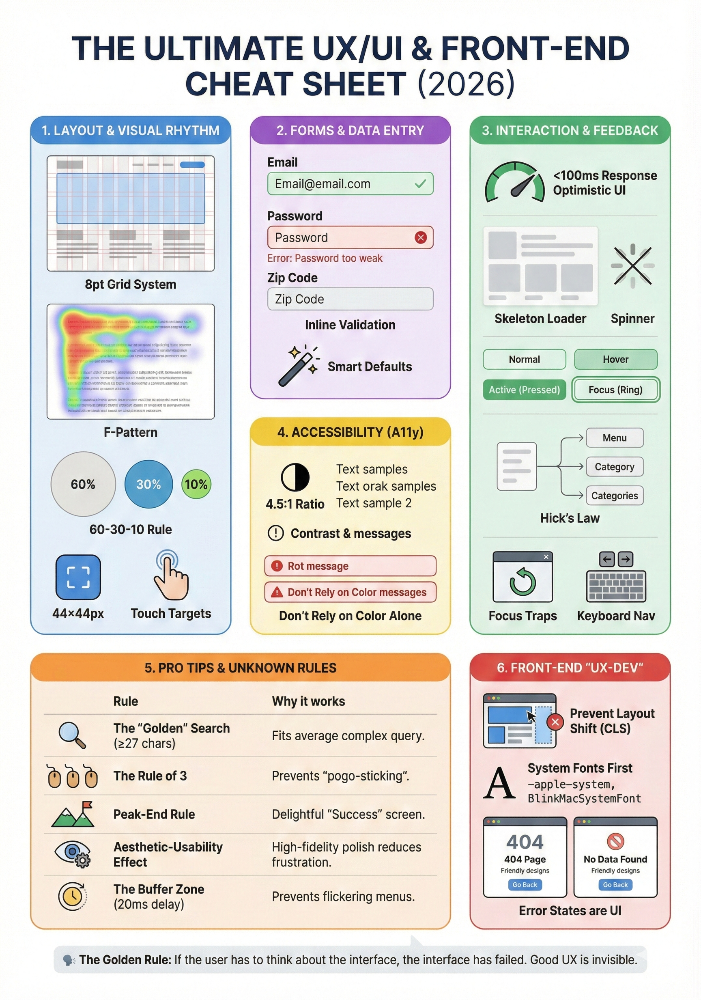

# 🚀 The Ultimate UX/UI & Front-End Cheat Sheet (2026)

A one-page reference for product teams: where high-level design theory meets the practical constraints of front-end development.

*Click the image for the full-resolution version (1728 × 2464).*

---

## 1. Layout & Visual Rhythm

* **The 8pt Grid System:** Use increments of 8px (8, 16, 24, 32...) for padding, margins, and heights. It ensures perfect alignment across all screen sizes and simplifies dev handoff.
* **Visual Hierarchy (F-Pattern):** Users scan web apps in an 'F' shape. Place your most important CTA (Call to Action) at the top right or top left, and use headings to anchor the eye.
* **The 60-30-10 Rule:** For color application: 60% dominant neutral, 30% secondary/brand color, 10% accent color (reserved for CTAs).
* **Touch Targets:** Ensure all interactive elements are at least **44x44px** to accommodate human fingers, even on "desktop" sites (which are often used on touch laptops).

---

## 2. Forms & Data Entry (The UX Engine)

* **Single Column Layout:** Multi-column forms are confusing. Stick to a single vertical line to reduce cognitive load.
* **Label Visibility:** Never use placeholders as labels. Once the user types, the context is lost. Use persistent labels above the input.
* **Inline Validation:** Don't wait for "Submit" to show errors. Validate fields (like email format or password strength) as soon as the user moves to the next field (*onBlur*).
* **Smart Defaults:** Pre-fill whatever you can (e.g., zip code based on location, or the user's previously used credit card).

---

## 3. Interaction & Feedback

* **The 100ms Rule:** Any interface response slower than 100ms feels "laggy." Use **Optimistic UI** (update the UI before the server confirms) for actions like "Likes" or "Deletes."
* **Skeleton Loaders > Spinners:** Use skeleton screens to mimic the layout during load. This reduces "perceived wait time" compared to a generic spinning wheel.
* **Active States:** Every button must have a `:hover`, `:active`, and `:focus` state. If it doesn't change when touched, the user thinks the app is frozen.
* **Hick's Law:** The time it takes to make a decision increases with the number and complexity of choices. Group long menus into categories or "Show More" progressive disclosures.

---

## 4. Accessibility (A11y) & Inclusivity

* **Contrast Ratios:** Maintain a minimum contrast of **4.5:1** for normal text.
* **Don't Rely on Color Alone:** Errors shouldn't just be red; they need an icon or text description for colorblind users.
* **Focus Traps:** When a modal is open, the "Tab" key should only cycle through elements inside that modal.
* **Keyboard Nav:** Ensure every action in your web app can be performed without a mouse.

---

## 5. Pro Tips & "Unknown" Rules of Thumb

| Rule | Description | Why it works |
| --- | --- | --- |
| **The "Golden" Search** | Search bars should be at least 27 characters wide. | Fits the average complex query without clipping text. |
| **Scent of Information** | Click count matters less than clarity: every link and menu label should make the next step obvious. | Users don't give up after 3 clicks; they give up when they lose the trail. Clear labels prevent "pogo-sticking" through deep menus. |
| **Peak-End Rule** | Users judge an experience based on its peak and its end. | Make the "Success" screen (after a task) delightful. |
| **Aesthetic-Usability Effect** | Users are more tolerant of minor usability issues if the UI is beautiful. | High-fidelity polish actually reduces user frustration. |
| **The Buffer Zone** | Give hover-dropdowns a short delay: ~100ms before opening and ~300–500ms before closing. | Prevents menus from flickering open/shut if a mouse just "glances" past, and keeps them open while the cursor travels into them. |

---

## 6. Front-End "UX-Dev" Best Practices

* **Prevent Layout Shift (CLS):** Always set `width` and `height` on images or use CSS aspect-ratio. Content jumping as images load is a major UX fail.
* **System Fonts First:** For data-heavy dashboards, use system fonts (`-apple-system`, `BlinkMacSystemFont`). They load instantly and feel "native" to the user's OS.
* **Error States are UI:** Design the "No Data Found" and "404" pages with as much care as the Home page. Give the user a clear way back.

---

> **The Golden Rule:** If the user has to think about the interface, the interface has failed. Good UX is invisible.

---

Made by [Evgeni Yordanov](https://github.com/eybox).

> **Note:** The README is the up-to-date version. Two rules have been revised since the image was made: "The Rule of 3" is now "Scent of Information", and the Buffer Zone delay has changed from 20ms to ~100ms open / ~300–500ms close.

## License

[CC BY-NC 4.0](LICENSE): you can share and adapt this cheat sheet for non-commercial use as long as you credit the author.
